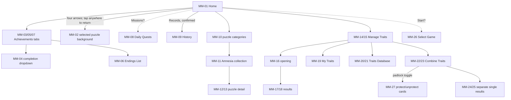

# Main menu reference: 24 October 2026

Implementation status, 25 October 2026: captured Home/account destinations are
integrated; [CURRENT-STATE.md](CURRENT-STATE.md) and [the branch report](BRANCH-INTEGRATION-2026-10-25.md)
record current scope and limits. This atlas preserves original screenshots and
target behavior; older statements about an unbuilt screen are historical.
Home/debug edits must persist to the shared account wallet. No real account
services or purchases are implied by displaying their reference layouts.

These **27 original-game screenshots** specify the home menu and its connected
screens. Originals are preserved, without resizing or renaming, in
[`screenshots/main-menu-2026-10-24/`](../screenshots/main-menu-2026-10-24/).
[`manifest.json`](../screenshots/main-menu-2026-10-24/manifest.json) records
dimensions, original filenames, capture order, attachment numbers and SHA-256.
This is a recreation specification, not evidence that these screens are already
implemented in d30mode. Read alongside [the earlier UI atlas](UI-REFERENCE.md).

## Evidence and scope

- **Observed** means visible in a supplied image. Navigation from a named button
  to a matching screen is a strong **inference** unless the user confirms it.
  Capture timestamps establish order, not the taps made between captures.
- **User-confirmed** follow-up: four arrows hide Home UI to expose the selected
  puzzle background; tapping anywhere restores it. Records opens History. Balances
  are cookies and refresh tokens; save-card numbers sum all five study stats;
  ending cookie amounts are rewards. Trait combining requires three inputs.
  Separate combine results use tier-colored confetti; Confirm fades in after
  0.5 seconds without a tap. Combining has **no roulette**. The padlock toggles
  protection-editing mode: tap individual cards to protect/unprotect them.
  Trait packs use a one-card roulette that **stops on tap**, without rerolls,
  and mixed brown/gray/gold confetti afterward. Stationery roulette must also
  finish with confetti in the different tier colors.
- Text inside images is source UI content, not an instruction to purchase, draw,
  change account data or implement a feature now. This task archives references
  and documents the UI; it does not change game behavior.
- Existing user requirements override the source: TODO 40 calls for completed
  runs under Records and incomplete runs under Play, with no leaderboard and
  an initially empty achievements area. Do not silently reintroduce Rank or
  paid account systems merely because they appear in these references.
- Account-owned traits, packs, puzzles, balances and mileage are distinct from
  the traits, stats and inventory belonging to a particular saved run. Repeated
  owned trait cards are visible; do not deduplicate them in this reference.
- Exact font family, animation timing, probabilities, purchase confirmations,
  persistence rules and platform back-button behavior cannot be recovered from
  still images. Missing screens are listed at the end.

## Screenshot index

IDs follow capture time so adjacent steps stay together. “Image” is the user's
attachment number, whose order differs from timestamp order. Each detailed
section links directly to its original.
MM-27 was supplied separately as a follow-up attachment; its Image 1 number
belongs to that later message, not the initial 26-image batch.

| ID | Capture time | Image | Screen/state |
|---|---|---|---|
| MM-01 | 19:18:12 | 1 | Home menu |
| MM-02 | 19:18:19 | 2 | Background-only view, Amnesia label |
| MM-03 | 19:18:26 | 3 | Achievements: University / Korea |
| MM-04 | 19:18:29 | 4 | Achievements: completion filter expanded |
| MM-05 | 19:18:33 | 12 | Achievements: Campaign |
| MM-06 | 19:18:41 | 13 | Campaign Endings List overlay |
| MM-07 | 19:18:46 | 14 | Achievements: Other |
| MM-08 | 19:18:56 | 15 | Daily Quests overlay |
| MM-09 | 19:19:03 | 16 | History / completed runs |
| MM-10 | 19:19:56 | 5 | Puzzles: category selection |
| MM-11 | 19:20:06 | 6 | Amnesia puzzle/background collection |
| MM-12 | 19:20:15 | 7 | Puzzle detail: Ihyeon's Break (F), 0/4 |
| MM-13 | 19:20:20 | 8 | Puzzle detail: Baking with SeoA, 2/4 |
| MM-14 | 19:20:28 | 17 | Manage Traits: Standard Trait Pack |
| MM-15 | 19:20:45 | 18 | Manage Traits: Jumbo Trait Pack |
| MM-16 | 19:20:51 | 19 | Jumbo pack opening stage |
| MM-17 | 19:21:06 | 20 | Five-trait results, another pack available |
| MM-18 | 19:21:15 | 21 | Five-trait results, Exit only |
| MM-19 | 19:21:25 | 9 | My Traits collection overlay |
| MM-20 | 19:21:31 | 22 | Traits Database: top / S tier |
| MM-21 | 19:21:37 | 23 | Traits Database: scrolled S-to-A boundary |
| MM-22 | 19:21:41 | 24 | Combine Traits: Standard |
| MM-23 | 19:21:45 | 10 | Combine Traits: Endless Winter |
| MM-24 | 19:21:53 | 25 | Single-trait reveal without controls |
| MM-25 | 19:21:56 | 26 | Single-trait reveal with Confirm |
| MM-26 | 19:22:58 | 11 | Select Game / incomplete saves |
| MM-27 | 19:32:39 | Follow-up 1 | Combine Traits: protection-editing mode |

## Navigation and overlay stack

This route map combines screenshot-based inferences and user confirmation,
as distinguished in each screen specification. Dashed links remain unconfirmed.

Full pages (History, Puzzles, puzzle collection, Select Game) use a back chevron
at top left. Achievements and Manage Traits have a top-right X. Child overlays
dim the parent rather than replace its visible header. Closing a child should
return to its parent, preserving the selected tab/category and scroll position;
this is a proposed recreation behavior, not proven persistence from screenshots.
Do not route a child X directly to Home. Full-screen reveals temporarily omit
the normal header, balance and navigation.

## Shared measurements and visual system

### Canvas, typography and backgrounds

The original files are **1080 x 2340** portrait images. The chat previews were
resized; measure the copied originals for final matching. For a 390-wide logical
viewport, the proportional reference height is 845; use `x * 390/1080` for source
pixel measurements. Handle actual device safe areas separately. Percentages below
are approximate visual bounds, not layout constants.

Use warm ivory paper (approximately `#fff9e9`), pale peach inset surfaces
(`#fff0dd`), coral orange (`#ff8c50`) for actions, peach/orange outlines, dark
brown text (`#4c2a08`), warm muted gray secondary text and soft downward shadows.
These colors are visual estimates, not sampled canonical tokens. Headers and most
labels are regular-weight sans serif; selected detail titles and reveal actions
are bolder. Preserve generous blank space. Reduce text size or wrap within cards
instead of clipping names. Source artwork and banner lettering have their own
styles and should not be replaced by plain text when original art is available.

The common desk background shows a large blue window, books to the right, a
yellow pencil case on the left, and an open notebook below. Home displays it
strongly; subordinate pages add a pale cream wash so content dominates. This
wash differs from the dark modal scrim. Keep background crop/alignment consistent
between pages. The narrow gray handle near the left lower-middle edge appears
across unrelated screens: treat it as a system/capture overlay, not game UI.

### Containers and controls

- Full-page headers occupy roughly the top **11%** of the image: centered orange
  title, left orange chevron, cream fill, thin peach bottom rule. Their title
  baseline is about 7% down the image.
- Achievements/Manage Traits use an orange title strip beginning around 1% down
  the image, white centered title, dark X on the right. Their children leave this
  strip visibly dimmed underneath.
- Large child panels are ivory with a thick coral outline, rounded corners and
  a dark scrim. Some use an orange square at the upper-right corner with a white
  X; others have a fixed Confirm/Close footer instead.
- Primary actions have a coral face and darker orange lower edge. Red is used
  for delete, remove-from-slot and Close controls. Disabled Open/Receive actions
  are gray. The project's existing requested press behavior applies: move the
  face downward toward the fixed lower edge, retaining the outline.
- Segmented controls show an orange selected segment and pale/gray inactive
  segments. A tab underline is a different control: Achievements uses an orange
  line under one of three equal-width text tabs.
- Scroll only the intended list or grid. Keep modal title/footer and the
  collection's top navigation visible. Partial bottom cards establish overflow,
  not a demand to shrink the entire grid to fit. A pale fade softens some clipped
  list bottoms. Only MM-22 clearly shows an orange in-app scroll indicator.

### Trait cards

These account collection cards differ from the green/red/purple **in-run trait
plates** already requested elsewhere. They have a dark-brown rounded outline,
soft shadow, a rank header separated by a horizontal brown rule, centered name,
and smaller muted centered description. Rank colors: S black, A muted yellow
olive, B gray, C dark ochre. Rank letters are cream/white. Winter cards place snowy
art behind their bodies; Retry Year cards use a muted pink/brown gradient.
Unavailable database cards use a dark translucent overlay across the whole card.
Protected combine cards additionally show a white padlock near bottom right.

## Individual specifications

### MM-01 — Home menu

[Original, Image 1](<../screenshots/main-menu-2026-10-24/Screenshot_20261024_191812_Korean Student Simulator.jpg>)

**Location/purpose:** account home, entry point to play, collections and records.
Desk scenery fills the canvas. A cream ruled-paper band runs down the right
quarter and across the lower portion; controls overlap its edge, leaving much
of the left scenery unobstructed.

**Layout:** gear and envelope squares at upper left (about 12% width each), a
small Cookie Parade seasonal badge underneath, and a large outlined balance pill
at upper right displaying cookie **53 / circular-C 522**. A descending right-edge
stack contains Rank, Traits, Puzzles, Records, Missions, Achievements, then a
larger filled-orange Start action with pencil icon. Buttons vary in width with
their labels and extend to the right edge; do not turn this into a centered grid.
The main stack spans approximately y=25–76%. All have cream faces, orange icons
and text, rounded orange borders and soft lower shadows, except Start's white
content on orange.

**Lower area:** a four-arrow square at left around y=64%; account name and orange
info circle below the scene divider around y=74%; Charging and Store tiles at
bottom left; a larger orange Notices tile at bottom right. Charging has cookie
art, Store a storefront, Notices a megaphone. Exact settings, mail, event, account
info, store, charging and notice destinations are not supplied. Start likely
opens MM-26. The user confirms Records opens MM-09, and the balance pill shows
**53 cookies / 522 refresh tokens** (circular-arrow/C-like token icon).
For d30mode, preserve the user's no-leaderboard requirement rather than adding
Rank as a working destination.

### MM-02 — Background-only Amnesia view

[Original, Image 2](<../screenshots/main-menu-2026-10-24/Screenshot_20261024_191819_Korean Student Simulator.jpg>)

**Observed:** the same desk scene now fills the entire image without Home's
right/bottom ruled-paper panels, currency or buttons. A wide translucent peach
rounded label/button reading **Amnesia** appears near the lower-right (x≈42–93%,
y≈90–94%). The window, framed photo, desk and sunlit notebook are fully exposed.

**User-confirmed interaction:** MM-01's four-arrow button hides the menu UI
and exposes the currently selected puzzle background. **Tapping anywhere** brings
the menu UI back. Amnesia is the selected background's label, not evidence of a
campaign-start action. This image is
also the best unobstructed reference for the full desk artwork and crop.

### MM-03 — Achievements / University / Korea

[Original, Image 3](<../screenshots/main-menu-2026-10-24/Screenshot_20261024_191826_Korean Student Simulator.jpg>)

**Entry:** Home → Achievements; University is selected. Orange title strip and
top-right dark X sit above University / Campaign / Other tabs. University has an
orange underline. A compact **All** dropdown aligns right beneath the tabs.
Below it is a raised four-part region bar: **Korea** selected orange, then
Special, Global, Taiwan on pale peach.

**Content:** scrollable two-column university cards, starting around y=26%.
Each is roughly 46% of screen width, nearly square, with a thick rounded colored
border and matching tinted body, a small colored star-rating capsule at top,
a large centered crest, university name and `# Enrollments` count. Korea Dream
University is blue with five stars and 9207; the adjacent Korea Movie card is
red with four-and-a-half stars and 2312. Lower visible cards are Drama, Culture,
Sports and Music. Preserve half-star rendering, crest proportions and the
regional selector independently of the completion filter. What tapping a
university opens, and whether counts are global/account totals, are unconfirmed.

### MM-04 — Achievement completion dropdown

[Original, Image 4](<../screenshots/main-menu-2026-10-24/Screenshot_20261024_191829_Korean Student Simulator.jpg>)

**State change from MM-03:** tapping the All control plausibly opens the aligned
menu directly underneath. Options are **All**, **Incomplete**, **Complete** in
three large pale peach rows, enclosed by one rounded orange border. The menu
matches the trigger width (about 31% of the canvas) and overlays the regional
bar and the top-right university card. There is no full-screen dimming.

**Expected interaction:** selecting a value filters the current category and
closes the menu. Outside-tap dismissal, filter retention when changing tabs and
whether all categories share this exact menu require confirmation. Do not move
underlying cards downward when opening this overlay.

### MM-05 — Achievements / Campaign

[Original, Image 12](<../screenshots/main-menu-2026-10-24/Screenshot_20261024_191833_Korean Student Simulator.jpg>)

**Entry/state:** select Campaign in Achievements. Its underline moves to the
middle third; All remains at upper right. The university regional bar disappears.
A two-column grid begins higher (around y=20%). Each campaign card has a thick
orange rounded border, peach fill, shadow, centered character bust and centered
campaign title/status. Amnesia shows a cookie icon with **50** and **2/13**.
Endless Winter shows a green check and **12/12**; The Year I Retook shows a
green check and **13/13** on the next row. Leave the unused lower area empty.

**Interaction:** campaign cards likely open MM-06's Endings List. Counts describe
campaign achievement/ending progress; do not confuse these with saved runs.
The user confirms the Endings List cookie amounts are completion rewards. The
Amnesia card's 50 likely aggregates such rewards; the exact aggregation is not
confirmed and must not be treated as a price.

### MM-06 — Campaign Endings List overlay

[Original, Image 13](<../screenshots/main-menu-2026-10-24/Screenshot_20261024_191841_Korean Student Simulator.jpg>)

**Parent:** MM-05 remains visible and darkened. A centered cream panel covers
x≈3–97%, y≈17–86%, with thick orange outline, large bold **Endings List** title
and a white X in an orange upper-right corner block. The list scrolls inside.

**Rows:** inset pale peach rounded buttons with orange outlines and lower
shadows; route/ending title aligned left, cookie amount or green check at right.
Long titles wrap and produce taller rows rather than clipping. Examples:
Ihyeon Route: Ending 2 → cookie **3**, Secret Ending → **5**; SeoA/Seowoo True
Endings 1 and 2 → **3** each; its Ending and Secret Ending → green checks;
Normal Ending 1 → **2**. Preserve this distinction. **User-confirmed:** cookie amounts are rewards for completing the ending,
not prices. Whether rows replay scenes or claim rewards is still unresolved. X closes
this child and exposes Campaign again.

### MM-07 — Achievements / Other

[Original, Image 14](<../screenshots/main-menu-2026-10-24/Screenshot_20261024_191846_Korean Student Simulator.jpg>)

**Entry/state:** select Other; underline moves to right third. Retain All filter.
Content is a single-column vertical list of wide pale-peach achievement cards,
approximately x=2–98%, with thin orange rounded outlines and soft shadows.
Title is larger than the progress/condition line. Completed entries have a
green circular check before the title and green condition text; incomplete
Story Addict has normal brown text, **Reach Campaign Ending 2/5**, and a cookie
**5** at the right. Other visible entries: Baby Steps / Tutorial Complete,
Enjoyer / Clear 31-Day Mode 5/5, Gym Rat / Reach Exercise Level 10 1/1,
Work Addict / Reach Part-Time Stage 10 1/1, Renaissance Man / Obtain 20 or more
Traits 1/1. Scroll the list. Reward claiming behavior is not shown.

### MM-08 — Daily Quests overlay

[Original, Image 15](<../screenshots/main-menu-2026-10-24/Screenshot_20261024_191856_Korean Student Simulator.jpg>)

**Entry:** likely Home → Missions, pending confirmation. Home remains dimmed.
Panel occupies x≈5–95%, y≈26–77%. Orange top title band says **Daily Quests**;
cream body has thick peach/orange outline and rounded corners. It centers the
instruction **Enroll in the following major**, a large crest, navy university
name pill (**Yeongwol University**) and **<Department of Nursing>** below.

**Status/footer:** reset text **10/25/2026, 00:00 AM**, reward cookie **4**,
gray **Receive** button, red **Incomplete** status and a prominent centered
orange **Confirm** button. Receive is visibly disabled in this state; its enabled
and claimed states are not supplied. Confirm dismisses plausibly to Home. The
captured reset string is an example, not a hardcoded date or proof of timezone.
No X appears on this particular panel.

### MM-09 — History / completed run cards

[Original, Image 16](<../screenshots/main-menu-2026-10-24/Screenshot_20261024_191903_Korean Student Simulator.jpg>)

**User-confirmed entry:** Home → Records opens History, matching TODO 40.
Full-page **History** header with left back chevron, washed desk background.
One tall card sits in the first position of an apparent two-column grid:
x≈9–48%, y≈14–44%. It has peach fill, thick light-orange rounded outline,
portrait in upper half, large **Greg Fiasco**, smaller **31-Day Mode (Elite)**,
and ending label **Realisation**. An attached orange top-right corner block
contains a white trash icon. Keep the large empty area when only one record
exists. A second column is inferred, not demonstrated by a second card.

**Interaction:** card likely opens completed-run details; trash likely deletes
that record, but neither result nor confirmation dialog is shown. Distinguish
completed records from resumable cards in MM-26. Do not implement Elite merely
to reproduce this example label.

### MM-10 — Puzzle category page

[Original, Image 5](<../screenshots/main-menu-2026-10-24/Screenshot_20261024_191956_Korean Student Simulator.jpg>)

**Entry:** Home → Puzzles. Full-page Puzzles header, left back chevron and washed
desk background. A centered three-line introduction explains collecting pieces,
using completed puzzles as background images and getting one complete puzzle
per purchased Expansion. Four wide rounded image banners run vertically:
**Amnesia**, **Endless Winter**, **The Year I Retook**, **Event Limited**.
Each spans x≈3–97%, is about 9% of image height, has an ivory border and lower
shadow, with gaps of about 3%. Preserve each banner's actual logo/art treatment:
outlined Amnesia lettering, blue Winter letters/stars/snow, pale serif Retry Year
on pink, and Event Limited on a stationery collage. Amnesia leads to MM-11;
other category contents are not supplied. Back returns toward Home.

### MM-11 — Amnesia puzzle/background collection

[Original, Image 6](<../screenshots/main-menu-2026-10-24/Screenshot_20261024_192006_Korean Student Simulator.jpg>)

**Entry:** MM-10 → Amnesia. Same page header style, now titled Amnesia. A
scrollable two-column collection begins immediately below the header. Artwork
thumbnails are roughly square with orange rounded borders; each regular entry
has a magnifier in an orange upper-right corner block, centered title underneath
and status/action below the title. Incomplete areas are darkened and show thin
white jigsaw seams; acquired areas retain normal brightness.

**Distinct first row:** left tile is a promotional complete-product draw showing
the baker, with separate orange **Insta-draw Complete Product / cookie 39** action;
right is the desk background **Amnesia** with a green check control underneath.
The screenshot does not prove whether the check means equipped, owned or both.
Following rows show **Ihyeon's Break (F/M)** with Buy **99**, then **Baking with
SeoA/Seowoo** with Buy **48** and a red **52%↓** badge. Additional cards continue
below. Magnifiers plausibly open the detail panels MM-12/13; exact Buy and
Insta-draw confirmation flows are not shown. Do not infer actual purchases from
the captions.

### MM-12 — Unstarted puzzle detail, Ihyeon's Break (F)

[Original, Image 7](<../screenshots/main-menu-2026-10-24/Screenshot_20261024_192015_Korean Student Simulator.jpg>)

**Parent:** Amnesia collection dimmed under an almost full-height cream modal
(x≈8–92%, y≈7–97%). Orange outline and white X in orange upper-right corner.
A large square, rounded brown-framed picture sits at top; all four puzzle areas
are dim, with white seams. Below: bold **Ihyeon's Break (F)**, bold muted-brown
subtitle **Plans for this evening?**, then **(0/4)**.

**Piece list:** pale peach rounded inset occupies the middle-lower area with
four rows and thin brown separators. Each row has a rotated jigsaw-piece thumbnail
at left, piece name and a muted rounded **Obtainment Condition** chip followed by
wrapped route ending condition. Visible: True Ending, Ending 1, Ending 2;
the fourth condition is clipped/faded and must not be invented. List viewport
scrolls independently of title and bottom action.

**Bottom:** three muted explanatory lines state pieces complete puzzles, Complete
Now immediately completes one and cost diminishes with more pieces. Outlined
bottom group contains orange **Complete Now**, cookie **99**, an empty brown
outlined progress bar, **(0% Completed)** and circular orange **?**. X returns to
collection. Help contents and completion transaction are not shown.

### MM-13 — Partially acquired puzzle detail, Baking with SeoA

[Original, Image 8](<../screenshots/main-menu-2026-10-24/Screenshot_20261024_192020_Korean Student Simulator.jpg>)

**Same component as MM-12:** baker picture has two bright acquired regions and
two dim regions, title **Baking with SeoA**, subtitle **Being an Emerald Cookie
Alchemist**, **(2/4)**. Missing pieces 1/2 show route conditions **True Ending 1**
and **True Ending 2**. Acquired piece rows 3/4 show green checks and green names
instead of the condition chip/text. Maintain per-piece acquired rendering.

**Bottom differences:** Complete Now price **48**, red **52%↓** badge, brown bar
filled just over half, **(52% Completed)**. The percentage is visibly **52%**
despite the count **2/4**: preserve them as distinct values, rather than assuming
all pieces carry equal progress/cost weight. Exact weighting is not established.
The image, list and purchase/footer elements remain inside one outlined modal.

### MM-14 — Manage Traits / Standard Trait Pack

[Original, Image 17](<../screenshots/main-menu-2026-10-24/Screenshot_20261024_192028_Korean Student Simulator.jpg>)

**Entry:** Home → Traits. Orange header: small cream **Chances Info** at left,
white **Manage Traits**, dark X at right. Beneath, a raised peach mileage card
has black circle M icon, thin brown-outlined horizontal pink-to-purple fill bar,
**490/1000**, and a centered two-line guarantee explanation. It says full mileage
guarantees an S-tier trait when opening a pack, and an earlier S-tier resets mileage.
Probabilities and the Chances Info view are not supplied.

**Pack panel:** large peach sheet below, with gray campaign selector
**Standard / Endless Winter / The Year I Retook**, orange selected Standard.
A horizontal pack carousel shows a large central orange **Standard Trait Pack /
Trait X 3** wrapper and part of the next pack on the right. Product details
between brown rules: title, cookie **15**, M **Mileage Gained: 10**, then
**Obtain 3 or more C-and-above Traits**. Large blank space separates description
from bottom ownership/actions. Footer inside panel: red **Owned: 0**, Cookies
Owned **53**, gray Open (disabled), raised-orange Buy.

**Bottom navigation:** three equal orange tiles: face icon **My Traits**, book
icon **Traits Database**, plus icon **Combine**. These open MM-19, MM-20 and
MM-22 as overlays. This is account trait management, not the in-run Traits panel.

### MM-15 — Manage Traits / Jumbo Trait Pack

[Original, Image 18](<../screenshots/main-menu-2026-10-24/Screenshot_20261024_192045_Korean Student Simulator.jpg>)

**Change from MM-14:** carousel centers a dark-navy-bordered **Jumbo Trait Pack /
Trait X 5**, with Standard partly visible left and Royal partly visible right.
Details update to cookie **20**, **Mileage Gained: 20**, **Obtain 5 or more
C-and-above Traits**. **Owned: 2** is normal brown, Open is now orange/enabled,
Buy stays orange. Mileage and cookie balance remain 490/1000 and 53.

**Interaction:** horizontal swipe/neighbor selection is inferred for the
carousel; it must update artwork, description, price, ownership and actions as
one product selection. Open likely consumes one owned pack and enters MM-16.
Buy likely acquires the selected pack but no confirmation or balance-change
screen is provided. Campaign segmentation is independent of carousel position.

### MM-16 — Pack-opening presentation

[Original, Image 19](<../screenshots/main-menu-2026-10-24/Screenshot_20261024_192051_Korean Student Simulator.jpg>)

**Entry:** opening Jumbo pack from MM-15 is a strong inference. All page chrome
is replaced by a near-black full-screen background with a large gray radial glow
around the center. Jumbo wrapper appears centered at x≈30–70%, y≈38–65%, at
roughly the same displayed width as the carousel's main pack. No title, close,
counter or action is visible. This is a presentation stage, not a blank loading
page. The user confirms trait opening uses a **single-card roulette**, similar to
stationery, **without rerolls**. After it ends, show combined **brown, gray and
gold confetti**. The user confirms the **roulette stops on tap**. The precise
wrapper-opening gesture and roulette speed remain unspecified. Do not infer a
duration from the 15-second gap between captures.

### MM-17 — Five-trait results with Draw More

[Original, Image 20](<../screenshots/main-menu-2026-10-24/Screenshot_20261024_192106_Korean Student Simulator.jpg>)

**Entry:** follows pack reveal. Same dark radial spotlight background, now with
mixed brown/gray/gold confetti (user-confirmed pack palette). A single rank-A **Master of 108 Bows** card is centered
(x≈33–67%, y≈41–55%), with left/right cream triangular navigation arrows near
the horizontal edges, vertically aligned with the card. The card text reads
**University acceptance chance X1.08**. Large white **1 / 5** is centered lower
down around y=68%.

**Actions:** two orange rounded rectangles side by side near y=76–83%:
**Exit**, **Draw More (1)**. Likely browse five obtained cards using arrows,
Exit returns to trait management, and Draw More opens the one remaining owned
Jumbo pack. Whether browsing is required before Exit/Draw More and whether arrows wrap
are not shown; confetti begins after the roulette ends, per user confirmation. Preserve the counter as a result index,
not the number of packs owned.

### MM-18 — Five-trait results without Draw More

[Original, Image 21](<../screenshots/main-menu-2026-10-24/Screenshot_20261024_192115_Korean Student Simulator.jpg>)

**Observed variant:** same reveal stage, arrows, **1 / 5** and confetti; centered
card is rank-C **Scientist**, **Study Efficiency for Science +1**. Only **Exit**
remains, centered beneath the counter. The preceding owned=2 and Draw More (1)
states suggest this is the second pack's results after exhausting ownership,
but this is not a recorded transaction. Do not leave an empty side-by-side slot
where Draw More used to be. This screenshot directly supports one stat per
displayed efficiency unit, consistent with the recent gameplay correction.

### MM-19 — My Traits owned collection

[Original, Image 9](<../screenshots/main-menu-2026-10-24/Screenshot_20261024_192125_Korean Student Simulator.jpg>)

**Entry:** Manage Traits → My Traits. Parent header is dimmed behind a tall
cream modal with orange outline, almost full width (x≈1–99%, y≈5–98%). Centered
large **My Traits** title, a three-column card grid within x≈9–91%, and a fixed
orange **Confirm** near the bottom. Title/footer stay outside the scrolling
grid; last row is clipped at its lower edge.

**Cards:** rank headers and visual variants follow the shared card rules.
Initial row: S Indestructible, S Time Jumper, S snowy Icy Logic. A-tier rows
follow. Two **Master of 108 Bows** cards and two **MBTI I. Introvert** cards are
visible: these represent separate owned copies. Do not collapse duplicates into
a single entry without another display for quantity. Names/descriptions resize
to fit their cards. Confirm likely dismisses to Manage Traits; card-tap detail
behavior is not supplied.

### MM-20 — Traits Database / S-tier top

[Original, Image 22](<../screenshots/main-menu-2026-10-24/Screenshot_20261024_192131_Korean Student Simulator.jpg>)

**Entry:** Manage Traits → Traits Database. Same tall child modal, now titled
**Traits Database**, fixed Confirm footer. Scrollable content groups a three-column
catalog by rank. The first rank heading is **S** left, **3/26** right, followed
by a thin brown horizontal divider. Cards are unique catalog entries here.
Most are darkened; owned examples **Indestructible** and **Time Jumper** are bright.
Ownership/unlock is the likely distinction; the screenshot does not establish
whether ever-owned but consumed cards remain bright.

**Useful text evidence:** darkened **Genius of the Century** explicitly says
**Study Efficiency for all subjects +3**; other S cards include God of Studying
+3, Korean Expert +10, Multilingual +10 and Ultimate Scientist +10. Gray overlay
does not hide names/descriptions. Snowy cards keep snowy art under the overlay.

### MM-21 — Traits Database / scrolled rank boundary

[Original, Image 23](<../screenshots/main-menu-2026-10-24/Screenshot_20261024_192137_Korean Student Simulator.jpg>)

**Same modal, scrolled content:** title and Confirm stay fixed while the top
of the grid is clipped beneath the title region. The final S cards include
Retry Year gradient-backed **Genius of the Generation**, **Prisoner**, **Don't
Retry**, **Exam Dreams**, **20-Year-Old Veteran**. Below a large gap, olive **A**
heading and **34/55** counter sit above a brown divider and the A-tier grid.
Bright and dark cards mix within one rank. This demonstrates a single vertically
scrolling grouped catalog, not a separate page per rank or selected campaign.
Preserve expansion-specific card skins without filtering them out of this view.

### MM-22 — Combine Traits / Standard

[Original, Image 24](<../screenshots/main-menu-2026-10-24/Screenshot_20261024_192141_Korean Student Simulator.jpg>)

**Entry:** Manage Traits → Combine. Tall cream child modal; small orange
**Combine Rates** at top left, centered **Combine Traits**, then gray campaign
selector with Standard orange. Across the upper half are **three empty square
slots**, each with a red remove button and white X directly underneath. Beneath
the slots is a wide orange **Combine** button plus separate orange **padlock**
button on the right. Thin brown divider separates this from the owned-card grid.

**Lower section:** three-column scrollable owned cards, orange scroll indicator
at right, lower clipping divider and fixed wide red **Close** footer. Protected
S cards Indestructible/Time Jumper are darkened with white padlock icons; unprotected
A cards retain normal brightness. The slots are empty yet Combine is visually
orange: do not infer enabled/disabled rules just from its color.

**User-confirmed:** exactly **three traits are required** to combine. Likely
interactions: choose owned cards into slots, slot X removes a selection, Combine
consumes selected copies and reveals a result, Close returns to Manage Traits.
The user confirms the **padlock toggles protection-editing mode**, in which
tapping individual cards protects or unprotects them. Combining has **no
roulette**: it reveals the result with tier-colored confetti and the delayed
Confirm control described in MM-24/25. MM-27 shows the active protection mode
and its changed layout. Allowed rank mixes,
odds and costs are not established. Trait combining is separate from stationery combining; do not
reuse the provisional 5% stationery upgrade rule here.

### MM-23 — Combine Traits / Endless Winter

[Original, Image 10](<../screenshots/main-menu-2026-10-24/Screenshot_20261024_192145_Korean Student Simulator.jpg>)

**Same modal:** Endless Winter segment is selected orange; Standard becomes gray.
Slots remain empty; layout and buttons stay fixed. Grid now contains six snowy
cards in two rows: S Icy Logic; A Decorator, Santa's Choice, Winter Child;
B Future Bandit Santa; C Smiling Child. The rest of the grid viewport is empty,
and Close remains at the same bottom position. This supports filtering available
combine inputs by campaign. It does not establish what happens to already
selected inputs when changing campaigns. Combine Rates is not supplied. The
padlock's interaction is confirmed in MM-22; MM-27 shows protection mode.

### MM-24 — Single-trait reveal without controls

[Original, Image 25](<../screenshots/main-menu-2026-10-24/Screenshot_20261024_192153_Korean Student Simulator.jpg>)

**User-confirmed context:** a separate combine result, distinct from MM-25.
The captured cards do not establish which inputs/campaign produced it. Dark full-screen radial
spotlight, one centered rank-C **Final Blow** card at x≈33–67%, y≈43–57%.
Description: **Study Efficiency for all subjects +5 the day before the Graduation
Exam**. No arrows, result count, confetti or actions are visible at this instant.
The user confirms combine results have **confetti matching the result tier**
and **Confirm fades in after half a second (0.5s)**. No tap is required to make
it appear. This capture shows the stage without the controls yet; it does not
establish the fade duration or exact confetti timing.

### MM-25 — Single-trait result with Confirm

[Original, Image 26](<../screenshots/main-menu-2026-10-24/Screenshot_20261024_192156_Korean Student Simulator.jpg>)

**Observed:** same dark radial stage, now brown/ochre tier-colored confetti and centered rank-C
**Fruits of Labour**, description **Initial Korean stats +100**. A single wide
orange **Confirm** button spans x≈15–85%, y≈76–83%. No arrows or counter.
This differs from multi-card pack results, which use Exit/Draw More and index.
Confirm likely closes the completed combine reveal and returns to Combine Traits
or Manage Traits; parent destination is unconfirmed. The user confirms MM-24 and MM-25 are **two separate combine outcomes**, not
successive frames of one changing result. Result confetti follows the card's
tier color (C is brown/ochre here), and Confirm fades in after 0.5 seconds.
This differs from the mixed brown/gray/gold confetti used after a pack roulette.

### MM-26 — Select Game / resumable runs

[Original, Image 11](<../screenshots/main-menu-2026-10-24/Screenshot_20261024_192258_Korean Student Simulator.jpg>)

**Entry:** likely Home → Start, matching TODO 40's desired Play destination.
Full-page Select Game header with orange left chevron; washed desk background.
Scrollable single-column list begins around y=14%. First card is an empty
**new game** tile: peach rounded rectangle with orange outline, lower shadow,
large centered orange circle with ivory plus. Its dimensions match the saved-run
cards beneath (x≈6–94%, height≈14% of canvas), separated by about 2% gaps.

**Saved cards:** character bust anchored left/bottom, then large **D-30 Greg
Fiasco** (or D-31/D-28), orange mode title **The Year I Retook** or **31-Day Mode
(Normal)**, and a smaller muted number **345 / 250 / 2464** on its own line.
**User-confirmed:** this number is the current sum of **all five study stats**;
for example, 50 in each subject displays **250**. Compute it from saved subject
stats; it is not a timestamp or currency. Red attached upper-right corner block has white trash icon;
separate this hit target from the card's resume action. Several cards continue
below, with a bottom fade. Unlike History, these cards are wide and horizontal
and show days remaining rather than an ending title. Plus likely enters new-run
setup, a saved card resumes that run, trash deletes it and back returns Home;
exact delete confirmation, ordering and save-count limit are not visible.

### MM-27 — Combine Traits / protection-editing mode

[Original, follow-up Image 1](<../screenshots/main-menu-2026-10-24/Screenshot_20261024_193239_Korean Student Simulator.jpg>)

**Entry and behavior:** toggle the padlock beside Combine in MM-22. The user
confirms that tapping individual owned cards in this mode protects/unprotects
them, rather than selecting combination ingredients. The padlock is a mode
toggle; toggling it again returns to ordinary combination selection. Protection
belongs to the individual owned copy, not every card with the same trait name.
Protected cards must be excluded from combination inputs.

**Visible layout change:** keep the dimmed Manage Traits parent, cream modal,
Combine Rates button, centered Combine Traits title and Standard-selected campaign
selector. The **three ingredient slots and their red X buttons disappear**.
The Combine/padlock row moves up from about y=38% in MM-22 to **y=23–28%** here,
with generous empty space between the selector and the row. The grid's top
divider also moves up, to about **y=30%**, and the first cards begin at **y=32%**.
This makes substantially more owned cards visible; do not retain blank slot
placeholders or keep the grid at its ordinary-mode position.

**Active controls:** Combine becomes pale peach with a faint warm outline/lower
edge and orange text, appearing inactive while protection is edited. The adjacent
padlock button becomes **dark burnt orange** with an even darker lower edge and
cream lock icon. This is the active protection-mode indicator, rather than a new
navigation destination. The red Close footer stays fixed near y=89–94%.

**Card states:** protected S-tier Indestructible and Time Jumper are darkened and
carry **large centered cream padlocks** over their name/body areas. Compare
ordinary MM-22, where their padlocks are small and near the lower-right corner.
Unprotected cards remain full brightness without locks. Preserve rank headers,
text, shadows and three-column geometry beneath the overlays. Multiple MBTI S.
Realistic copies are visible and remain separately editable. A narrow orange
scroll indicator sits at the right of the expanded grid viewport; clip the last
row at the brown footer divider. The gray handle at the far left remains a
system/capture overlay, not part of the grid.

**Unshown details:** protection persistence across app restarts and what happens
to selected ingredients when entering this mode are not established by the image.
Do not invent a save/confirmation dialog: none is visible.

## Questions and missing evidence

Evening follow-up: [new screenshots/recordings and recovered rates](ORIGINAL-GAME-FOLLOWUP-2026-10-24.md)
now specify Settings, mailbox, profile/rename, Charging, Store tabs, History's
three detail tabs, save deletion and locked-card warning. Protection persists
after restart; any S draw resets mileage. Use the updated status table in
[evidence requests](IMPLEMENTATION-EVIDENCE-REQUESTS.md) before asking again for
screens below; this older missing-screen paragraph is a historical checkpoint.

The user has confirmed the principal navigation, balances, save-stat total,
ending reward meaning and reveal details, including tap-to-stop trait-pack
roulette, no roulette for combining, and the padlock's tap-to-protect/unprotect
mode. These answers are integrated above. The follow-up protection-mode image
is archived and specified as MM-27; its active styling and expanded grid are
now observed rather than inferred.

The full remaining capture/rule checklist is now maintained in
[Implementation evidence requests](IMPLEMENTATION-EVIDENCE-REQUESTS.md), E01-E40.
The captured main-menu screens are now integrated; these are reference gaps, not
assertions that his latest features are missing. Rank is intentionally omitted.

Additional screens/interactions not supplied: Settings, mail, account info,
seasonal event, Charging/Store/Notices, achievement reward claim/university
detail, active/completed Daily Quest states, completed-run detail/delete dialog,
new-save/delete confirmations, puzzle help/equip/complete/purchase/draw flows,
other puzzle categories, Chances Info, Combine Rates, Royal/campaign pack details,
pack-wrapper gesture, roulette speed, protection persistence and
selected combine inputs. Roulette stops on tap; Combine Confirm timing
(0.5 seconds) is confirmed.
These gaps need not block faithful recreation of the states shown here.

## Roulette and confetti contract (user-confirmed)

| Flow | Roulette/results | Confetti | Completion controls |
|---|---|---|---|
| Trait pack | One card at a time, similar to stationery; tap to stop, no rerolls. Jumbo produces a browsable five-card result set. | Mixed brown, gray and gold after roulette ends. | Result arrows/index, Exit, and Draw More when another owned pack is available. |
| Trait combine | No roulette. One outcome from three input traits; MM-24/25 are separate outcomes. | Color of the resulting tier. | Confirm fades in after 0.5 seconds, without a tap to advance. |
| Stationery draw | Existing rolls-until-stopped behavior remains; this batch adds no stationery screenshot. | Add confetti using the different tier colors, as explicitly requested in the follow-up. | Existing stationery controls remain the reference; no new timing established here. |

These are documentation requirements for future recreation. In particular, do
not infer trait-combination probabilities from the stationery upgrade rules or
copy stationery rerolls into the trait-pack opening flow.

## Recreation checklist

- Use these account menu references alongside, not in place of, the earlier
  in-run UI specs. Keep completed History records separate from playable saves.
- Respect the user's no-leaderboard/initially-empty-achievements requirements;
  original achievement screenshots remain useful future component references.
- Match at the original aspect ratio, then verify narrow displays, long names,
  duplicate traits, empty collections, many saves, acquired/locked cards and
  partially complete puzzles. Preserve header/footer placement during scrolling.
- Separate ownership, discovery, protection, equipped state, result index and
  progress weighting. Do not derive one from a visually similar badge.
- Use original art locally where available. Archive images are reference material,
  not new application assets or proof that account purchases/odds were recovered.
- When implementing later, capture matching states with hardware rendering and
  compare overlays, proportions, crop, spacing and text wrapping. Still images
  cannot specify animation durations or replace performance measurements.
