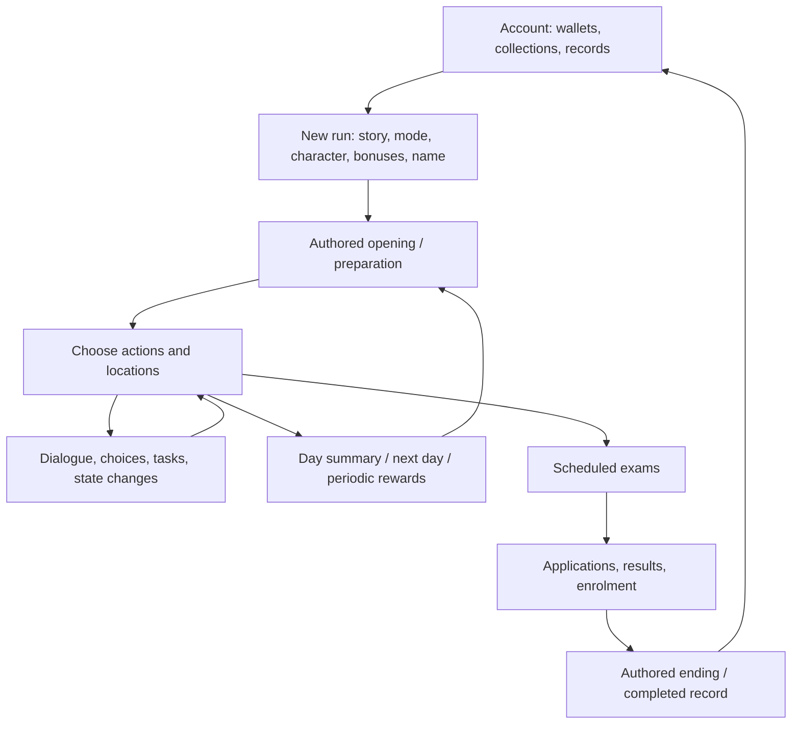

# Original Korean Student Simulator: functional reference

Research checkpoint: **24 October 2026**. This describes the original game,
including systems outside the two campaigns currently rebuilt in d30mode.
It combines original extracted JSON, recovered Korean sibling-build pseudocode,
native analysis, original-game screenshots, user playtest confirmations and
internet research. It is an evidence map, not a claim of full original parity.

Follow-up audit: [TODO entries 81-90](../TODO.md) distinguish implementation
defects, missing features and unrecovered models. See the remaining
[implementation evidence requests](IMPLEMENTATION-EVIDENCE-REQUESTS.md).
The recoverable main-menu/branch work is now integrated. Check
[CURRENT-STATE.md](CURRENT-STATE.md) and [the branch report](BRANCH-INTEGRATION-2026-10-25.md)
before treating audit-baseline defects as still open. User clarification: stationery
starts fresh each run; the same run's stationery survives save/resume. Do not
infer account persistence for stationery from other collection systems.

## Contents

Evening evidence supplement:
[30 screenshots, three recordings and trait-pack probabilities](ORIGINAL-GAME-FOLLOWUP-2026-10-24.md).
User corrections override older uncertain notes: protection persists after
restart; any S draw resets mileage; Master of Notes' workbook precedes general
completion gacha; continuous-condition mission failure notifies but unmet
end-of-day expiry is silent; first college enrolment unlocks its achievement
and grants two cookies. Inventory XP does not display the level-up event.

1. [Evidence, sources and versions](#1-evidence-sources-and-versions)
2. [Game structure and campaigns](#2-game-structure-and-campaigns)
3. [Account, home and persistent collections](#3-account-home-and-persistent-collections)
4. [Creating and continuing a run](#4-creating-and-continuing-a-run)
5. [Calendar, preparation, actions and movement](#5-calendar-preparation-actions-and-movement)
6. [Study, books, lessons and progression](#6-study-books-lessons-and-progression)
7. [Stamina, exercise, sleep and work](#7-stamina-exercise-sleep-and-work)
8. [Items, commerce and crafting](#8-items-commerce-and-crafting)
9. [Traits, characters, badges and Elite progression](#9-traits-characters-badges-and-elite-progression)
10. [Stationery](#10-stationery)
11. [Goals, missions, tasks and warnings](#11-goals-missions-tasks-and-warnings)
12. [Events, dialogue, conditions and effects](#12-events-dialogue-conditions-and-effects)
13. [Exams, admissions, endings and replay rewards](#13-exams-admissions-endings-and-replay-rewards)
14. [Campaign-specific systems](#14-campaign-specific-systems)
15. [Presentation, settings and services](#15-presentation-settings-and-services)
16. [Conflicts, unknowns and research priorities](#16-conflicts-unknowns-and-research-priorities)
17. [Native-function and catalog appendices](#17-native-function-and-catalog-appendices)

## 1. Evidence, sources and versions

### How to read a function entry

| Mark | Meaning | What it does not prove |
|---|---|---|
| **V** | Visible in original screenshots or explicitly confirmed by the user | General rules beyond the observed state |
| **D** | Present in original content data: schema, values, conditions or graph links | Exact execution order or compiled arithmetic |
| **N** | Located in original-native pseudocode/assembly or its registries | An unresolved closure's complete implementation |
| **W** | Described by a developer-published web/store page | Precise balance or internal algorithms |
| **R** | Reconstruction or interpretation from named evidence | A recovered original formula |
| **?** | Capability or detail still unresolved | Permission to silently invent an original rule |

Entries may combine marks: **D/N/?** means the feature exists in data/native
but some implementation detail remains unknown. A registry name is a discovery
lead, not proof that its English counterpart is playable or fully understood.
Catalog values are version snapshots, not promises about the live game.

### Primary local sources

Paths below are relative to this document. Short source keys are used throughout.

| Key | Source and scope |
|---|---|
| **G** | [Extracted global catalogs](../../kss/assetpack1_dec/assets/assets/global_data/): stories, characters, traits, books, items, universities, badges, equipment, endings, wallpapers and missions |
| **C** | [Extracted campaign directories](../../kss/assetpack1_dec/assets/assets/stories/): IDs 14, 3, 16, 18, 20 and 68; locations, events, sets, switches, calendars, levels, NPCs and media |
| **N** | [Recovered pseudocode](../../korstu4CLAUDE/private-build/korean-base/analysis/decompiled/app/app.dart), plus [analysis provenance](../../korstu4CLAUDE/private-build/korean-base/analysis/README.md); generated from the Korean native, not recovered developer source |
| **P** | [Main-menu reference](MAIN-MENU-REFERENCE.md), 27 user-supplied originals and interaction confirmations; [earlier UI atlas](UI-REFERENCE.md), 33 in-run/setup captures |
| **D30** | [31-Day content/native specification](D30-MODE-SPEC.md); useful source pointers but its RECONSTRUCTED blocks and historical interpretations are not authority over later evidence |
| **SETUP** | [Original setup reference](START-GAME-INITIALIZATION.md), separating observed flow from prototype implementation |
| **RY** | [Retry Year](RETRY-YEAR.md), [lifecycle evidence](RETRY-YEAR-LIFECYCLE.md), [roll-call/native correction](RETRY-FOLLOWUP.md) and [unresolved event ordering](RETRY-YEAR-EVENT-ORDER.md) |
| **ST** | [Stationery evidence](STATIONERY.md); its probability tables are explicitly provisional, and some presentation notes describe older implementation checkpoints |
| **OLD** | [korstu4CLAUDE durable notes](../../korstu4CLAUDE/CLAUDE.md), [expansion investigations](../../korstu4CLAUDE/EXPANSIONS.md), [older English mod tree](../../korstu4/mod-decoded/assets/assets/); source/version differences matter |

New audit outputs: [catalog/source fingerprints](original-game-source-audit.json)
and [complete extracted native registry index](ORIGINAL-GAME-NATIVE-INDEX.md).
They are generated by [audit_original_game.py](../tools/audit_original_game.py)
directly from original reference files, not from d30mode's generated packs.

### Internet sources checked

| Key | Source | Supported information and limits |
|---|---|---|
| **W1** | [English Google Play listing](https://play.google.com/store/apps/details?id=com.basakansoft.koreanstudentsimulator&hl=en) | Developer description of study/work/exercise, admissions, badges, traits, stationery, sharing and live department counts. Advertises 52 domestic universities and 2,087 majors; this is not the full extracted multi-region catalog count. |
| **W2** | [English App Store listing](https://apps.apple.com/us/app/korean-student-simulator/id6739276949) | Parallel developer description and existence of in-app purchases, including cookie bundles, ad removal and Retry Year product entries. Do not import live prices or product ownership into the rebuild. |
| **W3** | [Korean Google Play listing](https://play.google.com/store/apps/details?id=com.yeopcha.studentmaker&hl=en) | Original Amnesia premise: accident/memory loss before the exam; corroborates the broad admissions-management loop. Korean package is distinct from the English package. |
| **W4** | [Basakansoft](https://basakansoft.com/) | Developer identity and the game's positioning as a mobile university-entrance simulation. |
| **W5** | [Official game site](https://studentmaker.basakansoft.com/) / [Korean support site](https://student-maker.com/) | Public search exposed a probability-information link, but page extraction returned a JavaScript-required shell. No numerical odds were recovered from these pages. |

Search also surfaced community guides, a fan wiki and code/guide aggregators.
Those can suggest experiments but were **not used as authority for formulas**.
In particular, descriptions of optimal Retry Year routes and crafting payouts
need an original graph, native branch or controlled playtest before promotion
to a confirmed rule. Store reviews are not developer feature specifications.

### Version boundary

- The native decompilation is the **Korean sibling build**, documented locally as
  1.61.0. Most methods remain obfuscated and many dispatches are `stub(...)`.
- Local English projects include several versions: the source spec calls its
  extracted content 1.27.4; localization handoffs also discuss 1.29.0; the older
  `korstu4/mod-decoded/apktool.yml` identifies **1.25.0**. Do not treat all trees
  as one verified binary/content pair. The audit hashes identify the exact files
  inspected even when a catalog alone cannot establish its APK version.
- October 2026 public listings may describe newer versions than those files.
- Traditional Chinese `_tw` catalogs are separate variants. The island event
  graph was available only as `events_tw.json` in this extraction; its presence
  is not proof of a complete shipped English island campaign.
- Prototype conveniences—unlocked collections, no leaderboard, local JSON packs,
  fitted scoring and provisional draw odds—are **not original-game functions**.

## 2. Game structure and campaigns

The game combines a persistent account/collection layer with separate time-limited
student runs. A run selects a story, student, bonuses and identity, then spends
limited action opportunities while dialogue and state-dependent events unfold.
Exams/admissions and story-specific conditions select outcomes; collection
rewards provide reasons to replay. This high-level structure is corroborated by
the developer description. [English store description](https://play.google.com/store/apps/details?id=com.basakansoft.koreanstudentsimulator&hl=en)

Verified extracted manifest and campaign counts (**D**, G/C):

| Story | Catalog title | Dates, inclusive endpoints | Locations | Main events | Important distinction |
|---|---|---|---:|---:|---|
| 14 | Tutorial | 2024-11-06 to 2024-11-10 | 4 | 24 | Guided onboarding, `gameMode: tutorial` |
| 3 | Amnesia | 2023-08-08 to 2023-11-16 | 6 | 181 | Main D-100 story; manifest gameMode is null |
| 16 | 31-Day Mode | 2023-10-16 to 2023-11-16 | 11 | 147 | Short replay-oriented mode, `extra` |
| 18 | Endless Winter | 2023-11-24 to 2023-12-24 | 7 | 148 | Winter actions and routes, `extra` |
| 20 | The Year I Retook | 2024-10-14 to 2024-11-14 | 8 | 218 | Academy, dormitory, confinement, promotion, `extra` |
| 68 | 在無人島上學習 (island study campaign) | 2025-10-13 to 2025-11-13 | 7 | 257 | Count from `_tw` event graph; `extra` |

Dates include an exam/end endpoint: do not translate a 32-date inclusive interval
into 32 ordinary playable days. Counts exclude global system and character event
graphs. Localization branches and later downloadable campaigns are not all in
this English six-story manifest.



This diagram is a functional overview; it does not recover the scheduler's
same-tick event ordering or guarantee identical flow for every expansion.

## 3. Account, home and persistent collections

Sources: **P** (MM-01–27), **G** (wallpapers/endings/equipment/traits), **N**.

| Function | Original behavior or observed interface | Evidence / limits |
|---|---|---|
| Home scene | Selected puzzle/background behind a right-edge menu and lower account controls | V, MM-01 |
| Background inspection | Four-arrow control hides menu; tapping anywhere restores it | V, user-confirmed MM-02 |
| Cookie wallet | Persistent premium currency; visible in pack and puzzle prices/rewards | V/D; do not confuse with run Gold |
| Refresh-token wallet | Second Home balance; user identifies circular-arrow/C-like icon as refresh tokens | V; screenshot 53 / 522 is one account |
| Account information | Account name and information icon on Home | V; detail dialog not supplied |
| Settings entry | Gear at upper left | V; exact option inventory still incomplete |
| Mail/inbox entry | Envelope beside Settings | V; delivery/claim rules not recovered |
| Seasonal entry | Cookie Parade badge on Home | V; event-specific mechanics unverified |
| Charging entry | Cookie icon tile | V; do not invent recharge timers/rates |
| Store entry | Separate account storefront tile | V; distinct from run-Gold shop |
| Notices | Orange megaphone tile | V; content/service behavior not recovered |
| Rank/leaderboard | Rank button in original Home | V/W; intentionally omitted by user in d30mode |
| Completed-run History | Records opens History; cards show portrait, name, mode and ending | V, MM-09 |
| History deletion | Trash affordance on record | V; confirmation/recovery behavior unknown |
| Incomplete-run selection | Select Game lists resumable saves separately from completed records | V, MM-26 |
| Save summary total | Small number is sum of all five current study stats; five 50s show 250 | V, user-confirmed |
| Daily Quests | Target university/major, daily reset, completion state, cookie reward and Receive action | V, MM-08; Missions-to-dialog route inferred |
| University achievements | Regional catalog, crests, stars and enrollment counts | V, MM-03 |
| Achievement filters | University/Campaign/Other tabs; All/Incomplete/Complete dropdown | V, MM-03–07 |
| Regional grouping | Korea, Special, Global, Taiwan controls | V; region availability may vary by build |
| Campaign achievements | Campaign cards with ending progress; completed campaigns marked green | V, MM-05 |
| Endings list | Per-campaign discovered/undiscovered ending rows | V/D, MM-06, G/endings.json |
| Ending cookie rewards | Cookie amounts are rewards for completing endings, not replay prices | V/D, explicit user confirmation |
| General achievements | Conditions such as tutorial completion, run clears, exercise/work level and trait collection | V, MM-07 |
| Puzzle categories | Amnesia, Endless Winter, The Year I Retook, Event Limited banners | V, MM-10 |
| Puzzle pieces | Individual acquisition conditions; some link to specific ending codes | V/D, G/wallpapers.json |
| Piece ownership display | Bright acquired regions/green rows; dim missing regions with jigsaw seams | V, MM-11–13 |
| Complete Now | Spend displayed cookies to complete missing puzzle progress | V; transaction confirmation not shown |
| Weighted puzzle progress | Example 2/4 pieces displays 52%, price 48 and 52% reduction | V; equal piece weights would be incorrect |
| Background selection | Completed puzzles can be used as Home backgrounds | V; exact equip/check interaction partly inferred |
| Complete-product draw | Separate Insta-draw Complete Product action | V, MM-11; odds/pool unverified |
| Expansion background entitlement | Puzzle category explanation states one complete puzzle per purchased expansion | V; exact eligible product mapping unresolved |
| Persistent owned traits | Duplicate copies appear in My Traits | V; separate from one run's active trait set |
| Catalog discovery | Traits Database groups by rank, shows collection counts and darkened unavailable entries | V; ever-owned versus currently-owned marking unresolved |
| Account synchronization | `DBHelper.getDataWhenSignIn` tag and saved account/run collections | N; conflict resolution/offline policy not recovered |

## 4. Creating and continuing a run

Sources: **SETUP**, **P** (earlier setup atlas, MM-26), **G** characters/badges/traits,
and native account/run container fields.

| Function | Behavior | Evidence / limits |
|---|---|---|
| New-game entry | Plus tile in Select Game starts a new setup flow | V/R; destination inferred from control |
| Story selection | Story catalog supplies identity, calendar, start location, art, starting names and available content | D |
| Standard/Elite choice | Setup includes distinct difficulty choices and Elite information | V/D; exact full Elite modifier formula unresolved |
| Expansion entitlement | Story metadata/store products distinguish default and expansion content | D/W; local unlock patches are not original ownership rules |
| Character carousel | Student ID card, portrait, stars, name, effect description and selection | V/D |
| Character availability | `availableStoryIds` scopes eligible students | D; global catalog includes 65 records |
| Character ownership filters | Owned/collection views and completion counts | V; prototype unlock-all differs |
| Character draw entry | Promotion shortcut from character selection | V; full draw odds/duplicate compensation unverified |
| Gendered identity/art | Male/female player images and text branches in campaign data | D; availability differs by story |
| University badge loadout | Up to seven, displayed as four upper slots and three lower slots | V/D |
| Trait loadout | Up to five setup-selected traits; not every event trait is selectable | V/D; ownership/compatibility/consumption need version-specific checking |
| Name editing | First/last name fields and preview portrait | V; original length/blank validation unspecified |
| Setup initialization | Starting stats/money/levels and passive selections affect the new run | D/N; apply-once transaction structure is reconstruction |
| Initial day presentation | Navy countdown screen before preparation and goal announcement | V |
| Opening events | Some stories play scripted introductory events before ordinary actions | D/V; Retry Year notably differs from generic manifest location |
| Resume | Saved card restores an unfinished run | V/N |
| Delete unfinished save | Separate red trash target on each save card | V; no original save-count limit inferred from screenshot |
| Save identity | Profile/name, story/mode, character, date and stats survive continuation | V/N; d30mode JSON schema is not the original schema |
| Record conversion | Completed runs belong in History rather than resumable list | V; exact automatic save transaction unresolved |

## 5. Calendar, preparation, actions and movement

Sources: **C** locations/special_days/events/switches; **P** gameplay/preparation;
**N** `TimeManager` tags, `sub_b060c8`, `sub_b0702c`, run containers.

| Function | Behavior | Evidence / limits |
|---|---|---|
| Encoded game date | `DATE_YYYYMMDDTT`: final two digits are a tick, not wall-clock hour | D/N |
| Day countdown | D-number derived from campaign calendar; show weekday/date | V/D |
| Time progression | Actions advance daily progress; date-gated scenes use tick/date comparisons | D/N; exact lifecycle ordering partly R |
| Day start preparation | Traits, shop previews, equipped stationery, Books, Items, Score Card, Calendar and Start | V |
| Day start button | Leaves preparation for action selection | V; browsing menus does not itself spend action time |
| Action hand | Several offered blocks selected from location-specific action pools | V/D |
| Duplicate offered blocks | Duplicate ordinary action cards occur; draw is not universally without replacement | V; inspect `blockDuplicated` and action-specific restrictions separately |
| Action weight | Controls offer frequency; does not itself multiply payout | D/R with location labels and reference hands |
| Action availability | Character gates, condition callbacks, unlocked routes and location determine offered blocks | D/N |
| Refresh hand | Refresh resource permits replacing offered blocks | V/N; accounting distinct from stationery redraws and pack draws |
| School lessons | Scheduled/pinned classroom activity with subject/book-dependent gain | V/D; spread/formula not fully recovered |
| Movement | Location picker changes the active activity pool/background | V/D/N |
| Location unlock | Events can unlock or lock destinations, including lists and exceptions | D/N |
| Movement lock | Story can prevent travel or restrict destinations | D/N; confinement is one example |
| Location-specific effects | Study/work/sleep/exercise scopes depend on actual current location/type | D |
| Location visits | Native tracks visits and visit periods for conditions/rewards | N; `START_LOCATION_COUNT`, `END_LOCATION_COUNT` |
| Used-action constraints | Action pools carry duplicate-use flags and special callbacks | D; exact per-tick/per-day semantics require call-site recovery |
| Night summary | Navy day-result screen reports gains and weekly-goal state | V |
| Next-day transition | Day completion advances through summary/preparation, with periodic systems such as stationery | V/N |
| Special days | Campaign calendar carries mock exams, final exam and authored dates | D |
| Calendar display | Player can inspect scheduled entries | V/N, `SHOW_CALENDAR`; exact original discovery filtering still open |
| Lost remaining time | Exhaustion or story effects can end/consume remaining opportunities | D/N; do not invent original animation timing |

**31-Day destinations (D):** School, Home, Art Gallery, Gold Mine, Park, Library,
Café, Gym, Arcade, Football Field and Office. Some start locked. Library's
description emphasizes study frequency; Gold Mine/Café and exercise locations
have their own efficiency and action pools. Counts are 11 locations / 61 action
rows in the source specification; individual dynamic actions can be gated.

## 6. Study, books, lessons and progression

Sources: **G** book directories/study_levels/traits/equipment; **C** actions;
**P** cards and user confirmations. Arithmetic not directly recovered is marked.

| Function | Behavior | Evidence / limits |
|---|---|---|
| Subject stats | Five active subject slots; Korean, Maths, English and two electives in the inspected short campaigns | V/D/N |
| Positional subject effects | Index order is Korean=0, Maths=1, English=2, elective1=3, elective2=4 | N; do not use old English-before-Maths notes |
| Elective categories | Catalog has branches beyond a campaign's chosen two subjects | D/N, tamgoo predicates; not all five campaigns use identical elective sets |
| Study action | Selected book/subject increases the corresponding stat | V/D |
| Book power | Rank progression supplies power 5, 7, 10, 15, 22, 35 | D; power is an input, not the entire payout |
| Book unlock | Conditions include previous-book/after and stat thresholds | D/V |
| Book progress | Read count, completion target and extra reads are distinct fields | D/V |
| Book completion | `BOOK_DONE`, `DONE_BOOK_`, `UNLOCK_BOOK_CODE` and completion-triggered traits establish a real event boundary | D/N |
| Completion rewards | Master of Notes grants a Weird Workbook before the separate completion item gacha | V/user; F21/F22 and V01/V02 in evening supplement; general gacha pool/rates remain unrecovered |
| Study combo | Repeating subject/action history affects study behavior and conditions | D/N; exact multiplier/reset timing unresolved |
| Preview | Card shows projected subject gain, cost and book progress | V; preview and actual effect should agree |
| Base study gain | Current observed target: power-5 starter book gives +15 unbuffed | V/user playtest; universal `power * 3` formula across all versions is not proven |
| Study efficiency | One extra stat per boost unit; Genius of the Century +3 adds three, not nine | V, explicit user correction and original database capture |
| Subject-specific efficiency | All-subject, specific subject, elective-pair and weakest-subject effects | D |
| Conditional efficiency | Location, tick, inventory, probability and before-exam gates | D; evaluate each effect's own conditions |
| Lesson-specific efficiency | `schoolStudyPlusStat` and `excludeSchoolStudy` distinguish lessons from ordinary study | D |
| Study level | Ten named tiers with EXP thresholds and flat-plus fields | D; original displayed EXP scaling may differ from raw catalog thresholds |
| Starting stat modifiers | Character/badge/trait/Elite effects can change initial subject values | D; not recurring study bonuses |
| Random stat grant | Changers distinguish fixed subject, all subjects, random, high/low and elective variants | N/D |
| Study/stat history | Per-subject exam lists and study counters participate in conditions and records | N |

**Critical field conflict:** effects can contain `storyStat` and `extraStat`.
The original Genius screenshot says +3 while its extracted fields are 3 and 9.
Do not add both or prefer the larger field automatically. The current rebuild
prefers nonzero storyStat and falls back to explicit extraStat. That fallback is
an implementation policy, not proof that every zero-storyStat entry has been
reconciled with its description. For example, legacy High Potential text uses
`STAT_5` while extraStat is 15 and storyStat is zero. Audit A04 (2026-10-25):
when storyStat is zero and the trait's description writes the `STAT_<n>`
placeholder, the rebuild now treats extraStat as the x3-scaled field and pays
extraStat / 3 (High Potential +5, Entrepreneur +2); literal descriptions such
as Worth the Wait "+3" over extraStat 3 keep extraStat. Only those two traits
take that path. An in-game measurement (E23) would still confirm it.

## 7. Stamina, exercise, sleep and work

Sources: **P**, **C** exercise/work tables and actions, **G** effects, **N** verbs.

| Function | Behavior | Evidence / limits |
|---|---|---|
| Stamina spending | Ordinary actions have a visible cost modified by action/equipment/traits/levels | V/D; exact original cost curve remains unresolved |
| Stamina cap | 100 in the two inspected/rebuilt short campaigns, including dev/playtest boundary | V; no unsupported +4 per workout level |
| Workout efficiency | Exercise progression improves stamina efficiency rather than increasing this cap | V/D; original rounding must be measured |
| Exercise EXP | Exercise action, items and story effects can raise workout EXP | D/N |
| Workout level scene | Global level-up event can follow an EXP threshold crossing; inventory XP does not show the scene | D/V/user; distinguish event-granted XP from inventory use, keep level state updated |
| Work action | Earn run Gold through location/level-specific jobs | V/D/W |
| Work EXP | Separate level track, thresholds, money multipliers and EXP modifiers | D |
| Job descriptions | Location-specific shift labels change with work level | D |
| Work level scene | Separate global notification from workout level-up | D/V |
| Sleep/rest | Restore stamina, subject to location and passive modifiers | V/D; exact tick/day-ending distinction must be verified per action |
| On-sleep bonuses | Traits/items can grant stats or other effects when sleeping | D/N |
| Recovery items | Consumables restore stamina independently of sleep | D/V |
| Exhaustion | Global stamina-depleted event and default failure handler | D/N |
| Last-action boundary | Zero stamina on final action should finish the day without a separate depletion popup | V, user-confirmed target |
| Avoid collapse | Traits can preserve stamina at 1 instead of fainting | D; exact proc odds often unresolved |
| Exhaustion counters | Native tracks knockdowns, including `FUNC_NOCK_DOWN` spelling | N |
| Hunger/thirst | Separate expansion state exists; not a universal 31-Day resource | N/D, hunger verbs and island content |

Do not copy D30's older reconstructed sleep example as proof that every sleep
block ends the entire day. Likewise, a fitted gain/HP curve in `rules.json` is
not a native recovery merely because simulations terminate.

## 8. Items, commerce and crafting

Sources: **G/C** item catalogs and events; **P** inventory/shop; **N** item-effect
names and changers. [Effects guide](EFFECTS-REFERENCE.md) explains the rebuild's
parser, which is not itself the original implementation.

| Function | Behavior | Evidence / limits |
|---|---|---|
| Run Gold | Earned/spent within the student run; separate from account cookies/tokens | V/D |
| Run shop | Offers item artwork, price, effect preview and purchase action | V/D |
| Shop stock | Native tracks purchases and rerolls; catalog/shop lists determine offers | D/N; restock probability/cadence not fully recovered |
| Inventory browsing | Item name/art/count and use affordance | V |
| Consumable use | Executes the item's own effect; item-use counts participate in conditions | D/N; special tools can be persistent |
| Held passives | Non-consumable effects may be global, subject-specific or scoped to locations/types | D |
| Event acquisition | Fixed, random and list-based item grant verbs | D/N |
| Item receipt | Original acquisition UI identifies the obtained item and permits applicable use/confirmation | V |
| Removal variants | Single item, list, count-limited, random, once-only removals have separate names | N/D; do not collapse argument conventions |
| Item history | Conditions distinguish holding an item, acquiring it before and using it | N/D |
| Currency changes | Fixed/random gains, decreases and random assignment | N/D |
| Stat consumables | Fixed/all/random/subject stat effects | D; `CONSUME_STAT_n` scale differs from passive efficiency and needs individual verification |
| Passive efficiency tokens | `NORMAL_STAT_n` describes efficiency units; current user-confirmed contract is one stat per unit | V/D; do not reuse consumable x3 conversion |
| Random lotteries | Named lottery item effects exist | N/D; payout distribution unresolved |
| Trait-changing items | Acquisition/removal and bad-trait removal can occur through content | D/N |
| Safety/protection items | Home/Café/Library safety-related named handlers exist | N/D; exact hazard protection semantics unresolved |
| Special tools | Recipe, guide, notes, Scouter, gloves and exam kit are not interchangeable with ordinary consumables | D/N |
| Recipes/materials | Crafting interfaces and material ownership checks | D/N, `SHOW_RECIPE`, `SHOW_MATERIAL`, `LOOK_MAKING_GUIDE` |
| Food crafting | Retry Year `DO_MAKE_FOOD` and island `COOK` drive campaign-specific routes | D/N; complete recipe/payout parity not yet recovered |
| Gathering | `DO_GATHER` / island `GETGET` produce route/material opportunities | D/N; probabilities need recovery |
| Fishing | Island `FISH`, separate from ordinary study/work actions | D/N; exact minigame/loot behavior unresolved |
| Effect naming | Native string evidence includes `itemEffectCoffee`, `itemEffectEmeraldCookie`, `itemEffectRecipe`, etc. | N; names guide handler lookup but do not establish formulas |

The public store confirms earned money supports item purchases, separately from
account in-app purchase products. [Developer gameplay description](https://play.google.com/store/apps/details?id=com.basakansoft.koreanstudentsimulator&hl=en)

## 9. Traits, characters, badges and Elite progression

Sources: **G** characters/traits/badges/elite_levels, **P** MM-14–25/27 and setup,
**N** special action handlers. Distinguish **ownership**, **discovery**, **protection**,
**setup selection**, **active run effects** and **temporary event grants**.

| Function | Behavior | Evidence / limits |
|---|---|---|
| Trait ranks | S/A/B/C headers with tier colors; good/bad/neutral is a separate classification | V/D |
| Setup eligibility | `gachable`, story scope and collection state distinguish selectable versus event-only traits | D/V; not every catalog entry is a pack result |
| Temporary traits | Initial lifetime and run-day expiration fields exist | D; exact countdown boundaries need call-site verification |
| Location-scoped traits | Whole-trait location constraints can coexist with per-effect conditions | D |
| Starting effects | Initial stats, money, workout level and work level | D |
| Recurring effects | Study points, stamina-cost delta, recovery, work earnings, work/exercise EXP, goal rewards | D |
| Conditional procs | Effects gated by random comparisons, dates, ticks, actions, items and state | D; chance source must be checked independently |
| Factor effects | `percentPlusMoney/Exp/Reward` fields can be multiplicative factors such as 1.2 | D/R; verify stacking order rather than treating as flat 1.2% |
| Trait evolution | `EVOLVE_TRAIT` exists and is used by island content | D/N; full evolution graph not summarized here |
| My Traits | Owned-copy grid; duplicates retained | V, MM-19 |
| Traits Database | Unique catalog entries grouped by rank and ownership/discovery marking | V, MM-20/21 |
| Campaign pack pools | Standard/Winter/Retry selectors | V; exact pool contents/probabilities unresolved |
| Pack carousel | Standard, Jumbo and partially visible Royal products | V |
| Standard pack | Screenshot shows 3-or-more C-and-above traits, 15-cookie price, 10 mileage | V; version-specific displayed offer |
| Jumbo pack | Screenshot shows 5-or-more C-and-above traits, 20-cookie price, 20 mileage | V; version-specific displayed offer |
| Owned pack stock | Open disabled at zero, enabled with owned copies | V |
| Buy versus Open | Buying pack stock is separate from opening it | V/R; transaction screens not supplied |
| Mileage guarantee | At full 1000 mileage, opening guarantees S tier; ANY S-tier draw resets mileage | V/user; includes early and guaranteed S; detailed multi-card ordering unresolved |
| Pack reveal | Single-card roulette stops on tap; no rerolls | V, user-confirmed |
| Pack result browsing | Arrows and index show obtained batch; Exit and optional Draw More | V |
| Pack confetti | After roulette ends, mixed brown/gray/gold confetti | V, user-confirmed |
| Trait combination inputs | Exactly three owned traits | V, user-confirmed |
| Protection editing | Padlock toggles mode; tapping individual cards protects/unprotects | V, MM-27 |
| Protected styling | Large centered locks/dim cards in editing mode, small corner locks in ordinary combine view | V |
| Protection layout | Ingredient slots disappear, Combine appears inactive, active padlock darkens and grid expands upward | V |
| Combination result | No roulette; one result with result-tier confetti | V |
| Result acknowledgment | Confirm fades in after 0.5 seconds without an advancing tap | V; fade duration not specified |
| Combine Rates | Separate information button | V; rate content unprovided, no assumed percentages |
| Character passives | Structured effects and description both present; mismatches need reconciliation | D |
| Character special abilities | `specialFuncCode`/special actions, including medical/mechanic, copied effects and training routes | D/N; exact abilities not all recovered |
| Character events | Global event graphs can be filtered to selected character IDs | D; some effects may also be compiled |
| Badge collection | University-linked persistent bonuses used in later setup | D/V/W |
| Badge effects | Structured stat, money, recovery, cost, EXP or reward effects | D; badge data uses `effect`, not necessarily trait `effectList` |
| Elite account levels | Separate 37-entry level catalog with EXP and effect lists | D; availability, EXP awards and full difficulty arithmetic unresolved |
| Elite perks | Catalog examples include starting stats/money, sleep recovery, EXP and goal-reward modifiers | D; not evidence that prototype Elite is implemented |

## 10. Stationery

Sources: **G** equipment_items/equipment_item_sets, **P** earlier draw/inventory
captures and user corrections, **N/ST** weekday/navigation/redraw recovery.

| Function | Behavior | Evidence / limits |
|---|---|---|
| Equipment catalog | 72 records, with categories, ranks, stat bonuses and set IDs | D; global snapshot |
| Equipment sets | 18 set records, each names required item IDs and additional study stats | D |
| Individual bonus | All-subject or named-subject stat efficiency | D |
| Set activation | Matching required pieces adds a separate set bonus | D; stacking/equipped-copy handling still needs exact original verification |
| Equip/unequip | Dedicated inventory with equipped slots and card types | V/D |
| Thursday draw | Day-start route after Wednesday summary opens stationery draw | N/V; `sub_b060c8`, `sub_b0702c`, `/dokidoki_equipment_item` |
| Draw batch | Five cards shown in the reference | V |
| Rolling reveal | Stationery roulette rolls until stopped | V, user-confirmed |
| Draw confetti | Follow-up explicitly requires confetti in the different tier colors | V, user-confirmed presentation contract |
| Redraw quality | Reference advertises B-or-better redraws | V; exact rank probabilities unresolved |
| Lock positions | Keep selected card positions across a redraw | V/N; unlike trait protection this is draw-position locking |
| Redraw cost | First/free or ad-mediated flow and later one-cookie charge described in recovery notes | N/V/R; verify entitlement/ad differences per version |
| Inventory sorting/filtering | Tier/category views and ownership counts | V |
| Combining capacity | Four visible slots, accepting two, three or four copies per user correction | V; distinct from exactly-three trait combining |
| Tier result rule | User-directed reconstruction preserves best input tier (A+C→A, B+C→B) | V/R; original upgrade percentage not recovered |
| Upgrade odds | Exact original percentage unknown | ?; current 5% prototype default is not native evidence |
| Equipped/duplicate inputs | Must distinguish multiple copies and the currently equipped one | D/R; original consumption specifics require verification |

Do not publish d30mode's provisional 1/9/30/60 rank distribution as original
odds. The probability-information site could not be read beyond its script shell
during this research. [Official site](https://studentmaker.basakansoft.com/)

## 11. Goals, missions, tasks and warnings

Sources: **G** sudden_missions, **C** todos/events/calendar, **N** goal/task/warning
registries, **P** preparation/goal popup/Daily Quest.

| Function | Behavior | Evidence / limits |
|---|---|---|
| Weekly goal announcement | Start-of-week/first-day popup gives subject target and reward | V |
| Weekly renewal | UI strings state Monday renewal | N/V; partial first/last week handling needs original validation |
| Normal/hard goals | Distinct native goal categories | N |
| Stat rewards | Target subject and reward subject can differ | V/N |
| Trait goal rewards | Native names/log strings support trait awards | N |
| Delayed reward bonuses | Some planners/traits state effect begins next week | D/V; do not apply retroactively to an already-created goal |
| Goal history | Success records feed statistics and conditions | N |
| Sudden Missions | Nine templates across money/stat/stamina requirements and normal/hard variants; unmet end-of-day goals expire silently, continuous-condition violations notify failure | D/V/user; F23-F26 offer/success/failure; distinct from Home Daily Quests |
| Hold money target | `MONEY_OVER` | D; target generation unresolved |
| Subject threshold | `STAT_OVER` | D |
| Exact stamina | `HP_EXACTLY`, distinct finish-of-day `HP_EXACTLY_FINISH` | D |
| Stamina limits | `HP_NOT_UNDER`, `HP_BETWEEN` | D |
| Additional mission predicate | `STAT_EXACTLY` native evidence | N; not necessarily a template in this English catalog |
| Story tasks | Add/remove task, fixed/relative deadline, title mutation and weekly task verbs | D/N |
| Task due-day predicate | `FUNC_ROUGH_TODO_DAY` checks an active task on today's calendar day in recovered Retry native path | N; not days-remaining divided by seven |
| Task day count | `FUNC_TODO_DAY` is a separate function | N/R; partial-day rounding unresolved |
| Story release deadline | Retry confinement task 5 triggers evening release | D/N |
| Warning locations | Warning-factor/switch names and warning info icon affordance | N/V; probability formula unconfirmed |
| Warning controls | `TURN_OFF_WARNING_MISSION`, `RELOAD_WARNING_SWITCH`, location-random checks | N; names alone insufficient for implementation |

Goal thresholds/rewards are runtime-generated. Existing fitted d30mode curves
are not a recovered original generator.

## 12. Events, dialogue, conditions and effects

Sources: **C/G** event graphs, **N** registries, **P** event presentation;
[native index](ORIGINAL-GAME-NATIVE-INDEX.md) lists every extracted registered name.

| Function | Behavior | Evidence / limits |
|---|---|---|
| Event eligibility | Conditions reference date, location, switches, event states, items, traits, stats and functions | D/N |
| Storyline/event sets | Graphs group beats into weighted sets | D/N; exact selection distribution/dispatcher still incomplete |
| Event rank/priority | Records include rank, priority, customPriority, section and random-date fields | D; field existence does not recover sorting |
| Event tri-state | Unseen=0, playing=1, finished=2 | D/N; not a simple occurrence counter |
| Repeat/reset beats | Content can reset event state to re-enable a later day/event | D |
| Fake/silent events | Bookkeeping graphs apply effects without ordinary dialogue UI | D/N |
| Node traversal | Events consist of linked nodes with conditional/choice/end branches | D; exact host callback timing partly R |
| Dialogue | Main/alternate text, speaker IDs, standing actor, expression/clothing/background/BGM changes | D/V |
| Choice heading | Authored option text/question is separate from option labels | D/V |
| Conditional text | False condition may use alternate text or suppress the line | D/V |
| Unknown identity | Before revealed, talking person's label is ??? on dark plate | V, user-confirmed target; narration is a separate state |
| Portrait persistence | Standing actor can remain when player speaks or next line gives no replacement | D/V |
| Portrait hide/restyle | Explicit hide, expression and clothes updates independent of speaker text | D/V |
| Message backlog | Event history with title, lines, speaker labels and scrolling | V/N |
| Fast-forward | Event controls accelerate dialogue | V; precise original stopping/timing not fully documented |
| Runtime macros | Names, subjects, switch values, items, university/major labels and quiz placeholders resolve at runtime | D/N |
| Quiz questions | Shipped school question bank and question/correct/wrong placeholders | D; dedicated Quizmaster bank still unrecovered |
| Generated quizzes | Maths/English callback/macros may be generated rather than drawn from a static bank | D/N; fallback bank in rebuild is not native recovery |
| Changer dispatch | Events and location actions invoke named effect verbs plus switch changes | D/N |
| Switch mutations | Conditions/changers can set, add, subtract, bound or randomize state | D/N; argument conventions vary |
| Continuation switch | Node `continueTargetSwitch` can activate follow-up state at scene closure | D/N |
| Timed effects | Separate 17-name registry supports delayed effects, including `REMAIN_TIME` | N; effect timer units/order need verification |
| Task operations | `ADD_TODO`, `ADD_TODO_2`, `REMOVE_TODO`, `MODIFY_TODO_TITLE` | D/N |
| Action injection | `ADD_BLOCK`, `RELOAD_ACTIONS` and location changes alter available blocks | D/N |
| Story/ending transition | `SHOW_ENDING`, `END_GAME`, `EXIT_STORY` are distinct verbs | D/N; SHOW_ENDING can continue a new run's opening |
| Media/interface calls | Show image/puzzle/calendar/recipe, siren/blink, tutorial guidance | N/D; presence varies by campaign |

**Not recovered:** universal scene order, daily cap, set-versus-event lottery,
tie-breaking, probability curve and timing of immediate follow-ups. In particular,
numeric event-ID order is a rebuild choice, not established original placement.
See [the event-order investigation](RETRY-YEAR-EVENT-ORDER.md).

## 13. Exams, admissions, endings and replay rewards

Sources: **C/G** exams, special days, departments/universities, endings; **N**
exam/admission containers and predicates; **P** scorecards/achievements/history.

| Function | Behavior | Evidence / limits |
|---|---|---|
| School exams | Dedicated exam-use data and `START_SCHOOL_EXAM`/`CLEAR_SCHOOL_EXAM` | D/N; not every campaign schedules them |
| Short mock exam | `START_SHORT_MOCK_EXAM`, `END_SHORT_MOCK_EXAM` | D/N; tutorial invokes this family |
| Mock exams | `START_MOCK_EXAM`, `END_MOCK_EXAM` and result-dependent gates | D/N |
| Final exam | Authored Graduation Exam scene calls `START_SAT` | D/N |
| Per-subject results | Raw/standardized result data, grade/deviation/percentage names and history | D/N; complete stat-to-score formula unrecovered |
| Grade direction | Low grade number is better in recovered exam gates | D/N |
| Result comparisons | Current grade, mock grade, high/low result, difference from previous mock | N/D |
| Score Card | Player-facing results view | V |
| Department catalog | 3,358 entries with university IDs and deviation values in inspected global data | D; this is not the advertised domestic-only count |
| University catalog | 137 entries, including regional/special/non-university records | D; not all simultaneously available |
| Applications | Choose department/university applications using exam results | V/N/R; current rebuild's up-to-three UI is not by itself proof of native limit |
| Eligibility requirements | Some special departments need recommendation/product/state gates | D; exact entitlement behavior differs by version |
| Admission results | Acceptance decisions exposed to follow-up selection/ending predicates | D/N |
| Enrolment selection | Chosen university and major feed ending and badge logic | D/N |
| No acceptance outcome | Cram-school/retake outcome supported by store description and notUniv catalog entry | D/W |
| Acceptance modifiers | Traits/badges affect university acceptance chance | V/D; additive/multiplicative order unresolved |
| Admission counts | Real-time counts by department are an original online feature | W/V; not reproduced by local simulated numbers |
| Shareable results | Original promotes sharing report cards and acceptance letters, including photo customization | W; exact export UI not supplied |
| Ending eligibility | Admission, result thresholds, traits, route switches and event completion select endings | D/N |
| Career outcomes | 31-Day content includes sports, idol, gaming, business, cooking and comics branches | D |
| Ending presentation | Authored scenes and separate completion/result UI | V/D; exact general delay/reward display still incomplete |
| Ending catalog rewards | `endingCode`, localized ending name and optional `cookieCount` | D/V |
| Ending discovery | Campaign collection updates and green checks | V/D; repeat reward restrictions not recovered |
| Puzzle unlocks | Ending codes can satisfy wallpaper-piece conditions | D/V |
| History records | Completion stores an outcome summary for Records/History | V/N |

**31-Day ending content:** 14 `END_GAME` outcomes in its main graph. Authored
admission-tier gates include 99/95/90/80 thresholds and route-specific `ENDING_SW`
values. This confirms branching content, not the exact implementation of
`FUNC_IS_ENTER_UNIV_THAT_RATE`. Older notes mistakenly called
`FUNC_GET_SUCCESS_LENGTH` a study-combo length; newer admission recovery identifies
an acceptance-count use. Resolve each call site before assigning global meaning.

**Original scoring remains unknown.** Do not substitute d30mode's fitted
`meanTotal`, `sdTotal` or `admissionSpread` and describe it as recovered native
CSAT/admission arithmetic.

## 14. Campaign-specific systems

These are evidence-led capability descriptions, not complete walkthroughs or
promises that every callback works in the rebuild. **C** callback usage and source
counts are reproducible in the audit; **RY** has detailed native addresses.

### Tutorial and Amnesia

| Function | Behavior | Evidence |
|---|---|---|
| Tutorial coaching | Guided prompts, action reloads, goal dialog, short mock exam and final outcome | D/N, story 14 |
| Tutorial missions | `SHOW_SUDDEN_MISSION` appears in tutorial content despite its absence from the inspected Korean general changer registry | D; illustrates version differences |
| Amnesia opening | Memory-loss premise and D-100 calendar | D/W3 |
| Relationship routes | Branching meetings/choices and multiple route endings | D/V, Amnesia puzzle ending requirements |
| Amnesia exam progression | School exams and mock exams as well as final SAT | D, story 3 |

### 31-Day Mode

| Function | Behavior | Evidence |
|---|---|---|
| Career-specific blocks | Idol, pro-game, soccer, medical, mechanic and drawing actions | D/N |
| Career storyline progression | Route decisions, timed events and traits select career endings | D |
| Location unlock routes | Gym, mine, gallery, arcade, football and office content | D |
| Challenges | Challenge values and tasks track activity progression | D/N |
| Final exam spine | Calendar specifies final SAT rather than ordinary mid-run mock exams in this extracted story | D |

### Endless Winter

| Function | Behavior | Evidence |
|---|---|---|
| Winter movement/exploration | `DO_SKI`, `DO_EXPLORE` actions | D/N |
| Gift stealing | `DO_STEAL_GIFT` | D/N; exact loot/cost formula unresolved |
| Winter special action | `SSUL_MAE_ACTION` | D/N; label alone insufficient for complete behavior |
| Winter-only effects | Snowy trait cards and location/equipment-dependent bonuses | D/V |
| Time-limited objectives | Tasks/deadlines and winter event calendar | D |

### Retry Year / The Year I Retook

| Function | Behavior | Evidence and precision |
|---|---|---|
| Rejection-to-academy opening | Intro ending presentation, mother scene, academy welcome/test, Suin/Reflection Room | D/V/N; graph chain 1→169→2→3 |
| Opening continuation | SHOW_ENDING can set START and continue rather than terminate the new run | N, `sub_be91d0` |
| Reflection Room confinement | Location 20007 and ordinary-location availability toggled by `SET_DOK_BANG` | D/N, `sub_be99c0` |
| Release task | Task 5 provides tick-14 release gate | D/N |
| First dorm return | Hurry event 10 at tick 12 outside dorm drags player back | D/V |
| Later roll call | Event 11 depends on first Hurry completion and authored conditions; later nights can offer choice | D/N; not an unconditional first-night choice |
| Demerit confinement | Missed roll calls can trigger confinement and next-day deadline | D/N |
| Class promotion | Mock/performance and proficiency routes alter classroom access | D/N; specific native gates documented in RY |
| Study kit | Persistent Promotion Exam Kit reports `EXAM_POINT` | D/N; not consumed just to inspect |
| Notes/guides | Proficiency increments +5/+10/+20 recovered for exam-point items | N/D |
| Friend trouble actions | GO_PRO/GO_LEE/GO_BANJANG gates depend on rapport/health/date/state | N; explicit closures in RY |
| Rolling target day | `SET_NEXT_TARGET_BLOCK_CONDITION` advances target by three days | N |
| Banjang assistance | Help count progresses through diagnostic beats at 5, 12 and 22 | N/D |
| Mountain gathering | `DO_GATHER` raises temporary gathering event state | N/D |
| Food creation | `DO_MAKE_FOOD` uses a temporary craft action switch and event checks | N/D; recipes/payout parity incomplete |
| Karaoke | Increases SING_COUNT; item 90008 changes increment from one to two | N |
| Karaoke pay | `SING_MONEY` remote configuration controls payment | N/?; zero fallback in rebuild is not original pay |
| Singing opponent | Target uses `round(SING_POINT * 1.5 + rand(3))`; enemy from six choices | N, recovered sibling branch; RNG argument details should be checked in assembly before porting elsewhere |
| Singing challenge eligibility | Skill and win-state gates; SING_COUNT compared to target | N/D |
| Mock rating | Native raw-stat bands use 1500/1750, 3500/4250, 8500/9500 by stage | N; not exam scoring curve |
| Gold Sun wager | Subject stat thresholds 370 / 1180 / 2450 for bet stages 1–3 | N |
| High-class transition | Sets HIGH_GOGO and closes specified ordinary locations | N |
| Special admission | Elite Retry/Standard Retry catalog entries; recommendation needed for selected Elite departments | D/N |
| Singing continuation | `continueTargetSwitch` links challenge closing to result state | D/N |

The confirmed opening and individual gates do **not** establish original timing
for every eligible event. Full chronology remains unresolved.

### Island and broader Korean expansion capabilities

| Function | Behavior indicated by source | Evidence / limits |
|---|---|---|
| Island survival track | Hunger changes alongside stats, money, stamina and tasks | D, story 68 `_tw` graph |
| Fishing/gathering/cooking | `FISH`, `GETGET`, `COOK` with material/recipe interfaces | D/N |
| Weather scheduling | `NALSI_DATE`, `NALSI_RANDOM_DATE`, `NALSI_AFTER_DATE` | D/N; name/family suggests weather/date behavior; exact state semantics unresolved |
| Conch interface | `SHOW_CONCH` | D/N; do not invent interaction/minigame |
| Material/recipe guide | `SHOW_MATERIAL`, `SHOW_RECIPE`, `LOOK_MAKING_GUIDE` | D/N |
| Dynamic objective titles | `MODIFY_TODO_TITLE`, bounded target values and relative tasks | D/N |
| Detective investigation | Criminal search/selection, clues, suspicious points, stalker positions, message puzzles | N registry; later Korean campaigns not covered by six-story content audit |
| Dialogue recording | `RECORD_SPEAK`, `RECORD_SPEAK_ALL`, `SHOW_SPEAK_LIST`, `LOOK_BACK_LOG` | N; feature family, not exact UI reconstruction |
| Psychic route | Learn/practice skills, reward/tutorial popups | N; exact campaign mapping not recovered here |
| Creative/social activities | Voice, act, play game, piano/drawing/explanation/calm/feelings/yell click handlers | N; named hooks, complete mechanics unknown |
| Chapter navigation | START_CHAPTER, SHOW_CHAPTER, TURN_ON/OFF | N; registry presence only |

## 15. Presentation, settings and services

| Function | Observed or recovered capability | Source / limits |
|---|---|---|
| Layered portraits | Body/skeleton, expressions, clothing and other layers | C/G/P; internal pose names are lookup keys |
| Scene backgrounds | Location backdrops and event-specific background images | C/P |
| BGM and sound effects | Campaign/media catalogs and per-node references | C/G |
| Rich text | Authored bold/italic-style tags and runtime macro content | C/P; tag spelling varies |
| Raised buttons | Face/lower-edge depth and press movement | P/user correction; exact animation durations unspecified |
| Progress animation | Stamina and other meters are player-facing animated elements | V; rebuild's 300ms stamina tween is a chosen implementation value |
| Result stages | Dark radial reveal background, tier cards, confetti and delayed buttons | P/user-confirmed |
| Local/downloaded assets | `imgPath` plus HTTP paths/file manifests indicate bundled and remote assets | C/G/N; downloaded availability does not guarantee entitlement |
| Language variants | Original/translated text and separate `_tw` catalogs | C/G; do not translate functional identifiers |
| Settings/audio controls | Settings entry and in-run sound/music affordances | P/N; full account settings schema unresolved |
| Tutorial/review prompts | `REQUEST_TUTORIAL`, `COACH_TUTORIAL`, `REQUEST_REVIEW` | N/D |
| In-app sheet/browser | `REQUEST_IN_APP_SHEET`, `GO_WEB_BROWSER` | N; destinations not all recovered |
| Purchase ownership | `FUNC_IS_PURCHASED` and store product entries | N/W; not interchangeable with local unlock patches |
| Advertising/ad removal | Original listings disclose ads and ad-removal purchases | W1/W2; network reward mechanics not recovered |
| Online admission counts | Developer describes live department admission totals | W1; local-only rebuild cannot claim these are live |
| Account save sync | Sign-in DB path and native persistent-field names | N; exact server schema/conflict handling unknown |
| Error/retry orchestration | Recovered `sub_af073c` includes retrying exception control flow | N/analysis README; an architectural observation, not a desired gameplay rule |

The English App Store provides evidence of cookie, ad-removal and expansion
purchase products, not a stable pricing specification. [App Store products](https://apps.apple.com/us/app/korean-student-simulator/id6739276949)

## 16. Conflicts, unknowns and research priorities

### Corrections that must override older local interpretations

1. **Subject order:** Maths precedes English in positional effects. Elective slot
   ordering must match the selected campaign.
2. **Study efficiency:** Genius of the Century grants +3, not +9. Neither a larger
   `extraStat` field nor a shared x3 conversion proves the intended efficiency.
3. **Stamina:** no hidden 104+ reservoir from workout level in the inspected modes.
4. **Dorm events:** first Hurry precedes later eligible Roll Call; the rough task
   predicate is not a week/day countdown heuristic.
5. **Event order:** prerequisites identify availability, not exact dispatch time.
   Numeric IDs and prototype same-tick chains are not recovered chronology.
6. **Weighted selection:** location weights affect offers; event-set weights exist,
   but complete original dispatch/selection arithmetic remains unverified.
7. **Different combination systems:** three trait inputs, no roulette; two-to-four
   stationery inputs under the user's correction; original odds unresolved.
8. **Reveal controls:** trait-pack roulette stops on tap; combine Confirm appears
   after half a second without a tap. Confetti palettes differ by flow.
9. **Wallets:** Home cookies and refresh tokens are separate from run Gold.
10. **Snapshot counts:** 137/3358 extracted university/department records and the
    public 52/2087 domestic feature claim describe different scopes, not a verified
    contradiction or permission to drop regional records.

### Highest-value unresolved work

| Priority | Missing evidence | Why it matters / next useful action |
|---|---|---|
| 1 | General native event dispatcher/comparator and call sites | Original event order; inspect real closures or record dated/ticked playthroughs |
| 2 | Per-action stat/EXP/HP arithmetic and field variants | Avoid inflated gains; compare controlled before/after values with native handlers |
| 3 | Exact score conversion and admission probability | Fitted scores cannot establish original admissions fidelity |
| 4 | Original probability tables/remote config | Draw/combine/proc odds; inspect official probability screens/site and exact RNG branches |
| 5 | Character specials and crafting item handlers | Many content routes rely on compiled callbacks, not prose alone |
| 6 | Meta ownership, consumption and repeat rewards | Preserve account state without inventing duplicate compensation or repeat cookies |
| 7 | Weekly/sudden-goal generation and warnings | Names/templates exist but generators and risk math remain incomplete |
| 8 | Save/sync boundaries and full settings/account screens | Screenshot route evidence does not recover backend contracts |
| 9 | Remaining expansions and language availability | Korean capability registry is broader than extracted English manifest |
| 10 | Dedicated Quizmaster bank and generated quiz logic | School-exam fallback is not recovery of the requested original questions |

No APK installation, purchase, account mutation or game-code change is needed
for this documentation audit. Future recovery should preserve source hashes,
version identity and the distinction between observed behavior and a proposed fix.

## 17. Native-function and catalog appendices

### Verified global inventory

| Catalog | Records in inspected source | Qualification |
|---|---:|---|
| Stories | 6 | Includes regional/incomplete-English content |
| Characters | 65 | Campaign eligibility/ownership filters apply |
| Traits | 244 | Global plus story-scoped; not all setup/gacha eligible |
| University badges | 136 | University-linked effect records |
| Universities | 137 | Includes regional/special/non-university entries |
| Departments | 3,358 | Global multi-region snapshot |
| Stationery | 72 | Separate from ordinary inventory items |
| Stationery sets | 18 | Required-ID lists and bonus effects |
| Endings | 57 | Catalog is not proof every graph ending is localized/playable |
| Wallpapers/puzzles | 20 | Piece definitions include fixed/ending conditions |
| Sudden-mission templates | 9 | Difficulty variants counted as separate rows |
| Elite level records | 37 | Level 0 through 36, not necessarily 37 unlockable rewards |
| Study level records | 10 | Raw data thresholds need display-scale verification |

The audit fingerprints **65 global JSON catalogs** plus campaign JSON inputs.
It intentionally excludes `_tw` duplicates except the island graph fallback.
No dialogue, artwork or signed asset URL tokens are copied into the audit.

### Native registry coverage

[ORIGINAL-GAME-NATIVE-INDEX.md](ORIGINAL-GAME-NATIVE-INDEX.md) lists:

- **85 condition-registry names**, including `TEST` and `NOCTURNAL`; 83 begin
  `FUNC_`. This is a count from the current inspected pseudocode, not the older
  spec's historical 84-entry claim or an English-native count.
- **178 action/event changer verbs**, covering shared actions and expansion hooks.
- **17 timed-effect verbs**, a separate subset that includes `REMAIN_TIME`.

Each entry includes the registry source line and campaigns where this audit
found a matching JSON `funcCode` or `FUNC_` target. General native registration
is not equivalent to a decoded function body. The timed registry's overlaps
must not be counted as 17 additional unique gameplay features.

Regenerate from the original sibling trees with:

```powershell
python tools/audit_original_game.py
```

The [JSON audit](original-game-source-audit.json) includes source SHA-256 values,
per-campaign top-level list counts, callback/predicate occurrence counts and
registry membership. Occurrences include nested JSON fields; they are not runtime
frequency, probability weights or a count of unique player-facing features.
